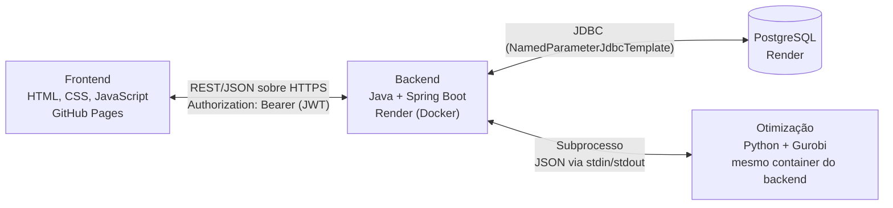

# Arquitetura — Mente Fria

**Equipe:** Leonardo Fagundes Oliveira (RA 2840482421009), Diogo Pereira Miranda (RA 2840482423006), Lucas Gabriel Valadares Bassi (RA 2840482423008), Kauê Nogueira Carneiro (RA 2840482423039)

**Trilha:** B (Origem do problema: Cliente Real)

**Última atualização:** 27/10/2026 (Sprint 3: Adendo nº 1 ao Termo de Aceite aprovado; decisões A1–A36 em `docs/Sprint_3/sprint-3-decisoes-e-pendencias.md`)

> **Status:** decisões D1 a D5 validadas pela equipe em 18/09/2026 (D4 registrada com base na experiência declarada da equipe — ver seção 2). Itens marcados como **proposta** ainda não foram validados e devem ser confirmados na implementação. As pendências estão na seção 8.
>
> **Contrato de Comunicação (20/09/2026):** as fronteiras **Java ↔ Python** e **Frontend ↔ Java** passam a ser definidas por `docs/Apoio/Contrato_de_Comunicacao_Mente_Fria.md`, que **prevalece sobre este documento** nos nomes de campo, nos valores de `status` e no formato de erro. As seções 3.1 e 3.3 abaixo resumem o contrato e apontam para ele.
>
> **Decisões de versão e configuração (25/09/2026):** o grupo respondeu as pendências de ambiente e configuração desta seção (detalhamento em `docs/Sprint_3/historico/Pendencias_ARQUITETURA_para_o_grupo.md`). O resultado está nas seções 2, 5 e 8, abaixo.
>
> **Situação em 27/10/2026 (Sprint 3) — prevalece sobre as notas mais antigas abaixo:**
> - **Objetivo do modelo: lucro estimado**, não receita (Adendo nº 1 ao Termo, aprovado em 27/10). Lucro por copo = preço de venda − custo dos ingredientes da composição.
> - **Estoque por linhas de entrada**, com baixa pela validade mais próxima (FEFO); estoque vencido nunca é vendido (D10). O saldo válido é o que vai para o Python.
> - **Dois módulos Python:** `otimizador.py` (produção) e `reposicao.py` (reposição com orçamento, US14). A D5 foi revista (abaixo).
> - **Gurobi 13.0.3** (P2). **Não há Compute Server.** Licenças: a **WLS acadêmica do Kauê** (pessoal, válida até 25/09/2027; A34) e a licença restrita do `pip` no desenvolvimento e nos testes. **No Render, o solver só roda com autorização escrita da Gurobi** (A30); sem ela, `OTIMIZADOR_HABILITADO=false` e as rotas de otimização respondem `503` (plano B1, A31).
> - **Deploy:** backend em Docker no Render (plano free), PostgreSQL 16 no Render, frontend no GitHub Pages por Actions; banco criado no sábado 31/10 à noite, sistema no ar até 30/11/2026, com backup testado (A21, A32).
> - **Datas e horas** vêm de um relógio em `America/Sao_Paulo` no Java (A9); `/api/teste/python` só no perfil `dev` (F4); **uma otimização por vez** (A27).
> - O código da Sprint 3 está **escrito e testado** em `docs/Sprint_3/referencia/` e entra nas pastas reais pelos PRs de cada fase (roteiro da Sprint 3).
>
> **Decisões de 08/10/2026 (histórico):** versão do Gurobi fixada em **13.0.1**; licença de produção será a do **Lucas**; terminologia do modelo passa a ser **Programação Linear Inteira pura**; nomes das variáveis `GRB_COMPUTESERVER`/`GRB_SERVERPASSWORD` e a medição do timeout aguardam a licença do Lucas. **Alternativa C confirmada pelo grupo para produção:** sem Compute Server; o `otimizador.py` usa a licença WLS acadêmica do Lucas diretamente no container do backend (seção 3.3). A Opção A (Compute Server em container à parte) foi validada e **descartada** por não ser viável no plano gratuito do Render.

---

## 1. Visão geral



Princípios que valem para todo o projeto:

1. **Só o backend fala com o banco e com o módulo Python.** O frontend nunca acessa nenhum dos dois diretamente.
2. **Permissões e regras de negócio vivem no backend.** O frontend apenas apresenta e esconde menus; nunca é a única barreira de segurança.
3. **O módulo Python é uma função pura:** recebe dados em JSON, devolve o resultado em JSON. Não acessa o banco nem recebe requisições do navegador. Isso é coerente com o Diagrama de Classes, em que o resultado da otimização fica em memória, sem histórico persistido.

---

## 2. Decisões de arquitetura

| # | Decisão | Alternativas consideradas | Motivo |
|---|---|---|---|
| D1 | **PostgreSQL** como banco oficial | MySQL | Render não oferece MySQL gerenciado gratuito. Migração registrada em `DER.md` (16/09/2026). |
| D2 | **Java chama o Python como subprocesso**, trocando JSON por stdin/stdout | (B) Python como serviço HTTP (Flask/FastAPI); (C) Python lendo o banco direto | Um único serviço no Render, sem framework web extra e menos processos para subir localmente. (C) foi descartada: duplica acesso a dados e contorna as regras do backend. O contrato JSON fica atrás de uma interface no Java, então trocar por (B) depois não afeta o resto do sistema. |
| D3 | **JWT no header `Authorization`** | Sessão por cookie; frontend servido pelo próprio Spring | Frontend (`github.io`) e backend (`onrender.com`) estão em domínios diferentes; cookies entre eles sofrem bloqueio em alguns navegadores. JWT não depende de estado no servidor (o plano Free reinicia o serviço) e não exige proteção CSRF. Servir o frontend pelo Spring exigiria abandonar o GitHub Pages (muda o Termo de Aceite). |
| D4 | **Spring `JdbcTemplate`** (`NamedParameterJdbcTemplate`) para acesso a dados | Spring Data JPA/Hibernate; JDBC puro | A equipe nunca usou JPA; o Lucas conhece JDBC. O SQL já existe (DDL, constraints, consultas do dashboard) e fica visível e revisável. Evita a curva do JPA e as armadilhas de chave composta em `produto_ingrediente` e `pedido_produto`. Custo: mais código por CRUD. Pode ser revisitada. |
| D5 | **Python/Gurobi apenas para a recomendação de produção** (US10/US11), modelada como **Programação Linear Inteira pura** | Incluir reposição (US14) e marketing (US18) | Nos documentos, US14 e US18 aparecem como métodos de `Ingrediente`/`Produto`, sem menção a Programação Linear. Ficam em Java. O modelo é "inteiro puro" porque todas as variáveis de decisão (quantidade de copos de cada produto) são inteiras, com função objetivo e restrições lineares. **Revista em 26/10/2026 (A19):** a reposição (US14) passou a usar o solver, porque ganhou orçamento (`reposicao.py`); o marketing (US18) continua em Java. O objetivo da produção passou a ser o **lucro estimado** (Adendo nº 1). |

Confirmado pela equipe em 18/09/2026: o plano Free do Render aceita Docker (necessário para a D2).

### 2.1 Versões e ferramentas (decididas em 25/09/2026; atualizadas em 08/10/2026)

| Item | Decisão | Observação |
|---|---|---|
| JDK | **25 (LTS)** | Atualizado em 27/09/2026 (era 21). Combinação recomendada pela própria documentação do Spring Boot 4.x. |
| Spring Boot | **4.0.8** | Atualizado em 27/09/2026 (era 3.3.4). Resolve a pendência de suporte — o 4.0.x é a linha atual e mantida. **Usa Jackson 3** (pacote `tools.jackson`), diferente do Jackson 2 da linha 3.x — ver a nota do Roteiro v3, seção 4. As anotações (`com.fasterxml.jackson.annotation`, como `@JsonProperty`) continuam no mesmo pacote. |
| Build | **Maven** | Mantém os comandos já usados no README e no Roteiro (`mvn spring-boot:run`, `mvn test`) |
| Python | **3.14** | Testado com o **3.14.0** em 26/10/2026 (47 testes). O 3.14.7, citado antes, **não foi testado** (sem impacto conhecido). |
| Gurobi | **13.0.3** — **definido em 27/10/2026 (P2)** | Antes 13.0.1 (08/10). As duas versões passaram nos 47 testes; o `optimization/requirements.txt` e o `Dockerfile` fixam `gurobipy==13.0.3`. |
| Modelo matemático | **Programação Linear Inteira pura** — definido em 08/10/2026 | Termo a usar em documentos, apresentação e código. Resolve o item de terminologia antes em aberto. |
| Licença do Gurobi | **Atualizada em 27/10/2026 (A34, A30):** desenvolvimento e testes usam a **licença restrita do `pip`** (pesquisa, desenvolvimento e avaliação; até 2.000 variáveis e 2.000 restrições). Existe uma **WLS acadêmica do Kauê**, de uso pessoal, válida até **25/09/2027**. **Não há Compute Server.** | No Render, o solver só roda com **autorização escrita da Gurobi**; até lá vale o plano B1 (A31). As decisões de 02/10 (Compute Server local) e 08/10 ("licença do Lucas", 90 dias) ficaram sem efeito. |
| Autenticação | **Spring Security + biblioteca de JWT** (ex.: `jjwt`) | |
| Conversão de porções (item B1 do Contrato) | **O frontend converte**, usando a `porcao_padrao` de cada ingrediente | Fecha também o item B1 da seção 2.4 do Contrato de Comunicação |
| Ingredientes vencidos na otimização | **Não contam** como estoque disponível | Desde a Sprint 3, o estoque é **por linha de entrada**: o Java soma só as linhas não vencidas (saldo válido) antes de montar o JSON (D10) |
| Fuso horário | **`America/Sao_Paulo`**, definido no Java (A9) | `hoje` e `agora` vão como parâmetro nos SQLs; o banco do Render roda em UTC |
| Execução do solver | **Uma otimização por vez**, com timeout de **10 s** (A27, P6) | Medido em 26/10: 188 ms numa máquina comum e 3,1 s no container com 0,1 de CPU |
| Responsável pelo módulo Python | **Kauê** | |

> **Nota de 27/10/2026:** os parágrafos abaixo sobre Compute Server e "licença WLS do Lucas" são **histórico**. A situação atual está no topo deste documento e na linha "Licença do Gurobi" da tabela acima.
>
> **Atualização de versões (27/09/2026):** o grupo trocou o JDK 21 → **25** e o Spring Boot 3.3.4 → **4.0.8**. Isso **resolve** a pendência de suporte que havia antes (o Spring Boot 3.3.x estava sem correções de segurança desde novembro de 2024; o 4.0.x é a linha atual). A troca também resolve a pendência do Python 3.14: o Gurobi confirma suporte a partir da versão **13.0.1**, agora **definida** (08/10/2026).
>
> **Confirmado em 28/09/2026: é mesmo um Gurobi Compute Server**, não só a licença WLS usada localmente. Isso muda a arquitetura da ponte com o Python no desenvolvimento — ver a seção 3.3.
>
> **Esclarecimento (08/10/2026) — "licença WLS Compute Server" e "modo WLS" não são licenças diferentes.** Segundo a documentação do Gurobi, a licença **WLS acadêmica** é uma só: ela roda diretamente em máquinas e containers (modo "cliente") **e** também permite subir uma versão "leve" de Compute Server (sem fila e com limite de 1 job). Ou seja, as licenças do Kauê e do Lucas servem para os dois modos; o que muda é só **como o `otimizador.py` as usa**. Em modo direto, a licença é identificada por `WLSACCESSID`, `WLSSECRET` e `LICENSEID` (no arquivo `gurobi.lic` ou em variáveis de ambiente). Confirmação prática, a cargo do Kauê e do Lucas: abrir o `gurobi.lic` de cada um — se tiver só essas três linhas e nenhuma `COMPUTESERVER`, a licença já está sendo usada em modo direto (é o que os testes do Kauê, em 30/09, indicam, pois o `otimizador.py` atual não aponta para nenhum servidor).

O **Contrato de Comunicação** (mantido pelo Kauê; revisado e aprovado em 20/09/2026) detalha as rotas REST, os erros e o formato JSON trocado com o Python.

---

## 3. As três ligações

### 3.1 Frontend ↔ Backend — REST/JSON sobre HTTPS

- **CORS:** o backend libera apenas a origem do GitHub Pages do projeto (e `localhost` em desenvolvimento).
- **URL da API:** site estático não tem variáveis de ambiente. A URL base fica em um `config.js` do frontend, com valores para local e produção.
- **HTTPS:** obrigatório (o GitHub Pages é HTTPS; chamadas HTTP seriam bloqueadas como *mixed content*). O Render já fornece certificado.
- **Autorização:** sempre validada no backend por perfil (CT05, CT08 e critério de bloqueio nº 5 do Plano de Testes).
- **Contrato:** rotas, formato de erro, códigos HTTP, CORS e convenções do JSON estão no **Contrato de Comunicação** (§2), que prevalece sobre este documento. Em resumo:
  - JSON em **snake_case**, com os mesmos nomes do DER.
  - Erro no formato `{ "mensagem": "...", "campos": { "campo": "mensagem" } }`, com **vários campos de uma vez** quando for o caso (US7); as mensagens vêm de `docs/Apoio/mapa_constraints.md`.
  - Códigos: `400` validação de campo ou regra de cadastro; `401` sem token/token inválido/credenciais inválidas; `403` perfil sem permissão; `404` inexistente; `405` método não suportado; `409` conflito (e-mail duplicado; Administrador já existe); `422` regra de negócio de uma operação (estoque insuficiente) ou erro de dados vindo do Python; `500` falha técnica; `503` otimização desligada no servidor (plano B1).
- **Cold start:** no plano Free do Render, o serviço dorme após 15 min sem uso e leva cerca de 1 min para voltar (medido na simulação: sobe em 83 s com 0,1 de CPU). Por isso o `config.js` usa **90 s** de tempo limite no GitHub Pages e 15 s localmente. O frontend deve ter um estado de "carregando" claro.

### 3.2 Backend ↔ Banco — JDBC (`NamedParameterJdbcTemplate`, D4)

- Credenciais sempre por variáveis de ambiente (`DB_*`), nunca no código.
- O `Script_DDL.sql` (pasta `bd/`) é a **fonte do schema**. A aplicação não cria nem altera tabelas.
- Todo SQL usa parâmetros (`?` ou nomeados). **Nunca** concatenar texto de entrada no SQL.
- Um `Repository` por agregado, isolando o SQL. As regras de negócio ficam nos `Service`.
- **Transações:** o registro de pedido (US12) grava `pedido` e `pedido_produto`, consome as **linhas de entrada válidas** da validade mais próxima para a mais distante (FEFO; `quantidade_restante`), baixa `ingrediente.quantidade_estoque` e insere uma movimentação `SAIDA` por ingrediente, tudo em **uma única transação**, com os ingredientes travados (`FOR UPDATE`) em ordem de id (CT25, concorrência). Invariante: o saldo do ingrediente é sempre a soma dos restantes das linhas.
- **Datas:** `data_pedido`, `data_movimentacao` e as comparações de validade usam `:agora` e `:hoje` vindos do Java (São Paulo, A9), nunca `CURRENT_DATE` do banco.
- As consultas agregadas do dashboard (US17) são escritas em SQL explícito.

### 3.3 Backend ↔ Python/Gurobi — subprocesso com contrato JSON (sem Compute Server desde 27/10/2026)

**Como funciona**

1. O backend lê o estoque, os produtos ativos e as composições no banco e monta o JSON de entrada.
2. Executa `python optimization/app/otimizador.py` (produção) ou `python optimization/app/reposicao.py` (reposição) com `ProcessBuilder` e envia o JSON pela entrada padrão, **uma execução por vez** (A27).
3. **Dentro do módulo:** o modelo é resolvido no próprio processo, com a licença disponível na máquina: a restrita do `pip` (desenvolvimento e testes) ou a WLS por variáveis `GRB_WLSACCESSID`, `GRB_WLSSECRET` e `GRB_LICENSEID` (só com a autorização da Gurobi para o Render, A30). **Não há Compute Server.** Com `OTIMIZADOR_HABILITADO=false`, o Java responde `503` sem chamar o Python (plano B1, A31).
4. O Java lê o JSON de saída na saída padrão, com **timeout de 10 s** (medido: 188 ms a 3,1 s).
5. Devolve o resultado ao frontend em linguagem de negócio (sem termos de otimização — US11).

No Java, a chamada fica atrás de uma interface (ex.: `OtimizadorProducao`), o que permite trocar a implementação e testar o restante com um dublê.

> **Histórico (02/10 a 08/10/2026), substituído pela situação de 27/10 no topo deste documento.**
>
> **Desenvolvimento — decidido pela equipe em 02/10/2026 (Kauê e Lucas):** cada desenvolvedor que precisa testar roda o seu próprio Compute Server localmente, com a própria licença acadêmica WLS. Assim, `GRB_COMPUTESERVER` aponta para `localhost:porta`, não há dependência de rede entre computadores, e o limite de "1 job por vez, sem fila" da licença acadêmica não gera conflito entre os dois.
>
> **Produção — validação da "Opção A" (container à parte em nuvem), feita em 08/10/2026.** O grupo indicou a Opção A, pedindo antes uma validação de custo e de sentido para o escopo. **Resultado: não recomendada no plano gratuito do Render.** Motivos:
>
> - **Plano gratuito do Render é insuficiente para um servidor de otimização:** cada serviço gratuito tem 0,1 CPU e 512 MB de RAM, desliga após 15 minutos sem tráfego e leva cerca de 1 minuto para religar; não tem disco persistente nem recebe tráfego pela rede privada. *Private services* não têm instância gratuita (a partir de ~US$ 7/mês). Um Compute Server que "dorme" entra em conflito com o timeout de 10 s da chamada.
> - **A RAM já é um risco no serviço do backend:** Java + Python + `gurobipy` dividindo 512 MB (medição pendente, seção 8). Um segundo serviço só aumenta o custo.
> - **Regras da licença acadêmica WLS:** (a) uso **não comercial e não operacional**; (b) a chave só pode ser usada pela pessoa titular (o Lucas) e não pode ser compartilhada; (c) validade de **90 dias**, e tanto a geração quanto a **renovação exigem conexão à rede de uma instituição acadêmica reconhecida** (a Fatec); (d) o modo Compute Server da licença acadêmica é "leve": **1 job por vez e sem fila**; (e) requer internet permanente durante a otimização.
> - **Tecnicamente** (a partir da versão 8 do Gurobi) o servidor usa uma única porta HTTP/HTTPS, então hospedá-lo em um serviço web seria possível em tese, mas **não foi testado** e não resolveria os pontos acima.
>
> **Alternativa C (DECIDIDA em 08/10/2026): sem Compute Server em produção.** O `otimizador.py` usa a licença WLS "cliente" diretamente, dentro do mesmo container do backend (como a arquitetura original previa e como os testes do Kauê já funcionam, conforme relato). As credenciais (`GRB_WLSACCESSID`, `GRB_WLSSECRET`, `GRB_LICENSEID`, da licença do Lucas) entram como variáveis de ambiente no Render. Vantagens: um único serviço, sem custo adicional, sem servidor extra para manter e sem o problema do cold start de um segundo serviço. Custo: o container precisa de acesso à internet (o Render tem) e a RAM precisa ser medida.
>
> **Alternativa D:** manter o Compute Server em produção, em serviço pago (ex.: *private service* do Render) ou em outra nuvem. Foge do custo zero e exigiria pesquisa de outras opções.
>
> **Respostas do grupo e esclarecimentos (08/10/2026):**
>
> - **Renovação da licença:** o grupo informou que a aplicação serve apenas ao trabalho acadêmico e que, depois da demonstração, não deve ser mais usada. Então a renovação a cada 90 dias **só será necessária se a demonstração cair depois do vencimento da licença**. Cuidado prático: a licença do Lucas vale 90 dias **a partir da geração**, e gerá-la (ou renová-la) exige estar na rede da Fatec. Conferir a data de validade assim que ela chegar e comparar com a data da apresentação final.
> - **Enquadramento nas regras do Gurobi:** a licença acadêmica é gratuita para cursos, ensino e pesquisa em instituição de ensino, e **não pode ser usada em trabalho comercial ou operacional**. Uma demonstração acadêmica se enquadra no uso previsto; **usar o sistema no dia a dia da açaiteria depois da disciplina não se enquadraria**. Recomendações: (1) registrar no README que o uso é acadêmico; (2) o piloto com o cliente real deve se limitar à demonstração, sem operação contínua; (3) se o cliente quiser continuar usando o sistema depois, será preciso outra licença ou outro solver (fora do escopo desta entrega). Esta é uma leitura dos termos publicados, não um parecer jurídico; em caso de dúvida, consultar o professor ou o suporte do Gurobi.
> - **Por que um Compute Server?** Pelo esclarecimento da seção 2.1, a licença WLS acadêmica funciona sem ele. Não há exigência técnica identificada que obrigue o Compute Server em produção.
> - **A Alternativa C é viável?** **Sim.** Ela usa o mesmo tipo de licença que o Kauê e o Lucas já têm, só que em modo direto. Pontos de atenção: (a) o `otimizador.py` precisa receber as credenciais — hoje o gurobipy lê o `gurobi.lic` da máquina; no Render o mais simples é o script ler `GRB_WLSACCESSID`, `GRB_WLSSECRET` e `GRB_LICENSEID` das variáveis de ambiente e passá-las ao criar o ambiente do Gurobi (ou montar o `gurobi.lic` como arquivo secreto do Render); (b) a licença acadêmica permite **2 sessões simultâneas** em modo direto, melhor que o limite de 1 job do modo Compute Server; (c) a RAM de 512 MB do serviço precisa ser medida com Java + Python + gurobipy; (d) o container precisa de internet (o Render oferece).
>
> **Decisão (equipe, 08/10/2026): Alternativa C confirmada.** Em produção não haverá Compute Server: a Opção A fica descartada e a Alternativa D (serviço pago) não será necessária. O Compute Server continua opcional **apenas no desenvolvimento**, para quem quiser usá-lo. Consequências práticas: (1) o `otimizador.py` passa a receber as credenciais da licença do Lucas por variáveis de ambiente do Render (`GRB_WLSACCESSID`, `GRB_WLSSECRET`, `GRB_LICENSEID`) ou por `gurobi.lic` como arquivo secreto — ajuste a cargo do Kauê; (2) o consumo de RAM do container (Java + Python + gurobipy, 512 MB no plano gratuito) será medido no deploy; (3) o uso da licença é exclusivamente acadêmico, restrito à demonstração.
>
> **Continua valendo:**
> - **Timeout de 10 s ainda é só uma estimativa.** Só será medido quando a licença do Lucas chegar e os testes começarem. Mesmo local, a chamada ao Compute Server tem uma etapa de rede a mais que a solução local "pura".
> - **Nomes `GRB_COMPUTESERVER` e `GRB_SERVERPASSWORD`** seguem como proposta até a licença do Lucas chegar.

**Contrato**

A requisição, a resposta e as regras estão no **Contrato de Comunicação** (§1), que prevalece sobre este documento. Em resumo:

- **Nomes iguais aos do DER:** entrada com `ingredientes[].quantidade_estoque` e `custo_unitario` e `produtos[].composicao[].quantidade_utilizada`; saída com `status` (`"sucesso"` ou `"erro"`), `receita_estimada`, `margem_estimada` (lucro estimado), `recomendacao` (**um item por produto recebido**, com `quantidade` inteira ≥ 0) e `consumo`.
- **O Java envia todos os ingredientes usados por produtos ativos, inclusive os com estoque 0.** Nunca se filtra por "estoque > 0": se um ingrediente em falta sumisse da lista, o Python não saberia limitar os produtos que o usam. Só entram produtos com `ativo = true`. **Estoque vencido não conta:** `quantidade_estoque` é o **saldo válido**, a soma do que resta nas linhas não vencidas.
- Estoque e quantidades chegam **na mesma unidade do ingrediente** (kg, l, un). Quem converte porções (Tela 09) em quantidade é o **frontend** (item B1 do contrato, confirmado em 25/09/2026).
- "Estoque insuficiente para qualquer produto" é **`sucesso`** com todas as quantidades 0; o frontend mostra uma mensagem amigável. O `erro` fica para problemas de dados (produto sem composição, ingrediente ausente da lista).
- **Código de saída `0`** = há JSON válido na `stdout` (inclusive com `status: "erro"`); diferente de `0` = falha técnica (o `stderr` vai para o log). **UTF-8** nas duas pontas. **Timeout de 10 s** (provisório). O backend nunca expõe *stack trace* ao usuário.
- `receita_estimada` e `margem_estimada` são informativas: o Java **recalcula com `BigDecimal`** a partir das quantidades, dos preços e dos custos.
- **Modelo de produção (Sprint 3):** estágio 1 maximiza o lucro estimado; estágio 2 desempata produto por produto, na ordem de cadastro, mantendo o lucro máximo. **Reposição:** maximiza a menor cobertura da necessidade dentro do orçamento, depois usa a sobra, depois desempata pelo mais consumido. A descrição completa está no tutorial do Kauê (`docs/Sprint_3/sprint-3-tutorial-python-kaue.md`) e no código de `docs/Sprint_3/referencia/python/app/`.

---

## 4. Autenticação e autorização

```
1. POST /api/auth/login   { email, senha }   →  { token, nome, perfil }
2. Frontend guarda o token e redireciona conforme o perfil (US3)
3. Demais chamadas:       Authorization: Bearer <token>
4. Backend valida assinatura e validade, depois confere se o perfil acessa a rota
   →  200, ou 401 (token inválido/expirado), ou 403 (perfil sem permissão)
```

- O token carrega id do usuário, perfil e validade. **Validade de 2 horas** (definida na Sprint 3; `app.jwt.validade-horas`). Não há revogação antes de expirar — aceitável para o MVP. Todas as respostas `401` e `403` vêm em JSON.
- Senhas armazenadas apenas como hash (`senha_hash`); mínimo de 8 caracteres validado na aplicação (US1, CT02).
- A chave de assinatura fica em variável de ambiente (`JWT_SECRET`). **Nunca** no código nem no repositório.
- O token fica em JavaScript no navegador, então o frontend deve evitar `innerHTML` com dados digitados por usuários (mitigação de XSS).

---

## 5. Variáveis de ambiente

| Variável | Usada por | Descrição | Status |
|---|---|---|---|
| `DB_HOST`, `DB_PORT`, `DB_NAME`, `DB_USER`, `DB_PASSWORD` | Backend | Conexão com o PostgreSQL | Em uso (README) |
| `JWT_SECRET` | Backend | Chave de assinatura dos tokens (32 caracteres ou mais) | Usada pelo código da Sprint 3 (`referencia/`); no Render, gerada pelo *blueprint* |
| `CORS_ALLOWED_ORIGIN` | Backend | Origens do frontend liberadas no CORS (no Render: a origem do GitHub Pages, sem barra no fim) | Usada pelo código da Sprint 3 |
| `PORT` | Backend | Porta HTTP (o Render define; localmente, 8080) | Usada pelo código da Sprint 3 |
| `PYTHON_CMD` | Backend | Comando para chamar o Python (`python`, `python3` ou `py`, conforme a máquina). **O valor é ajustado por cada integrante no próprio `.env`**; o nome da variável é o mesmo para todos | Planejada (README) |
| `OTIMIZADOR_SCRIPT` | Backend | Caminho do script `otimizador.py`, relativo à pasta de onde o backend inicia (hoje `../optimization/app/otimizador.py`). Valor ajustado por integrante no `.env` | Usada pelo código da Sprint 3 |
| `REPOSICAO_SCRIPT` | Backend | Caminho do `reposicao.py` (`../optimization/app/reposicao.py`) | Usada pelo código da Sprint 3 |
| `OTIMIZADOR_HABILITADO` | Backend | `true` (padrão) chama o Python; `false` faz produção e reposição responderem `503` (plano B1, A31) | Usada pelo código da Sprint 3; **`false` no Render** até a Gurobi autorizar |
| `OTIMIZADOR_TIMEOUT_SEGUNDOS` | Backend | Tempo limite de cada execução do Python (padrão 10) | Usada pelo código da Sprint 3 |
| `MF_PYTHON` | Testes do backend | Caminho do Python com `gurobipy`, para os testes que chamam o Python de verdade (opcional) | Só nos testes |
| `GRB_COMPUTESERVER`, `GRB_SERVERPASSWORD` | — | Eram para o Compute Server | **Descartadas** em 27/10/2026 (A34: não há Compute Server) |
| `GRB_WLSACCESSID`, `GRB_WLSSECRET`, `GRB_LICENSEID` | Módulos Python (repassadas pelo Java) | Credenciais da WLS acadêmica, **pessoal**, do Kauê (A34) | Só o Kauê as usa. No Render, **só com a autorização escrita da Gurobi** (A30); nunca no código nem no Git |

O `.env` real nunca é versionado; o `.env.example` lista as variáveis sem valores.

---

## 6. Deploy

| Bloco | Onde | Observação |
|---|---|---|
| Frontend | GitHub Pages | Arquivos estáticos |
| Backend + Python | Render, **um serviço** via Dockerfile (JRE 25 + Python 3.14 + `gurobipy` 13.0.3), plano free, região Virginia, *health check* em `/api/saude` | Arquivos prontos em `docs/Sprint_3/referencia/deploy/` (`Dockerfile`, `.dockerignore`, `render.yaml`) |
| Banco | PostgreSQL 16 gerenciado do Render, plano free | **Expira 30 dias depois de criado**: criado no sábado 31/10 à noite, vale até 30/11/2026, data-limite da avaliação. Backup com `pg_dump` e restauração testada (A32) |
| Frontend | GitHub Pages publicado por **GitHub Actions** (a pasta `frontend/` não é raiz nem `/docs`) | *Workflow* pronto em `docs/Sprint_3/referencia/deploy/frontend-pages.yml` |

**Atualizado em 27/10/2026 (US20 entrou na Sprint 3):** o deploy do esqueleto não chegou a ser feito nas Sprints 1 e 2. A imagem foi **simulada localmente** com os limites do plano free (512 MB, 0,1 CPU): sobe em 83 s, pico de 133 MiB de memória, fluxo completo sem falhas. O serviço free dorme após 15 min sem uso. No Render, o solver só roda com a autorização da Gurobi (A30); até lá, `OTIMIZADOR_HABILITADO=false` (plano B1).

---

## 7. Roteiro de implementação

| # | Passo | O que prova | Sprint |
|---|---|---|---|
| 1 | Subir PostgreSQL local (Docker) e rodar `Script_DDL.sql` com o seed | Banco reproduzível por todos | 1 |
| 2 | Backend conecta ao banco; `GET /api/saude` (`SELECT 1`) e `GET /api/ingredientes` | Backend ↔ Banco | 1 |
| 3 | Página HTML que faz `fetch` em `/api/ingredientes` e lista o resultado, com CORS | Frontend ↔ Backend ponta a ponta | 1 |
| 4 | Login por perfil com JWT; frontend trata 401/403 (US1–US3) | Autenticação e autorização | 1 |
| 5 | `otimizador.py` + `pytest` (CT23, CT24) usando o contrato JSON, sem Java | Módulo Python isolado e testável | 2 |
| 6 | `POST /api/producao/recomendacao` (só Administrador) chamando o Python | Backend ↔ Python | 2 |
| 7 | Deploy do esqueleto (Pages + Render) — antecipado para o fim da Sprint 1 | Ambiente real | Não foi feito nas Sprints 1–2; **deploy definitivo na Sprint 3** (US20, sábado 31/10) |
| 8 | Sprint 3: estoque por linhas, pedido com baixa, recomendação por lucro, reposição, dashboard, marketing e deploy | Fluxo do Termo de ponta a ponta | 3 (roteiro da Sprint 3; código de referência validado em `docs/Sprint_3/referencia/`) |

---

## 8. Pendências

**Decididas pelo grupo em 25/09/2026** (`docs/Sprint_3/historico/Pendencias_ARQUITETURA_para_o_grupo.md`) — ver a tabela da seção 2.1:
- Versões de JDK, Spring Boot, build tool, Python e licença do Gurobi.
- Autenticação (Spring Security + JWT).
- Conversão de porções (item B1 do contrato) e ingredientes vencidos na otimização.
- Responsável pelo módulo Python.
- README atualizado com as variáveis novas da seção 5 (`JWT_SECRET`, `CORS_ALLOWED_ORIGIN`, `PYTHON_CMD`, `OTIMIZADOR_SCRIPT` e as credenciais WLS).

**Atualizadas em 27–28/09/2026:**
- JDK 21 → 25; Spring Boot 3.3.4 → 4.0.8 (resolve a pendência de suporte que havia antes).
- Confirmado: Gurobi **Compute Server** com licença WLS acadêmica — ver seção 3.3 (e o esclarecimento sobre os modos de uso da licença na seção 2.1).

**Resolvidas em 02/10/2026:** onde o Compute Server roda durante o desenvolvimento (cada desenvolvedor, localmente, com a própria licença).

**Resolvidas em 08/10/2026:**
- **Versão exata do Gurobi:** 13.0.1.
- **Terminologia:** o modelo é de **Programação Linear Inteira pura** (resolve o item de terminologia antes em aberto com o professor).
- **Qual licença será usada em produção:** a do **Lucas**.
- **Timeout do Python e valores das variáveis de ambiente:** cada integrante ajusta no próprio `.env` (os **nomes** das variáveis são únicos para todos — ver seção 5).

**Respondidas em 08/10/2026:**
- **Renovação da licença do Lucas:** só será necessária se a demonstração cair após o vencimento (90 dias a partir da geração). Uso previsto: exclusivamente acadêmico/demonstração (seção 3.3).
- **Enquadramento nas regras da licença acadêmica:** uso acadêmico se enquadra; uso operacional contínuo pelo cliente depois da disciplina não (seção 3.3).

**Decidida em 08/10/2026 — produção:** **Alternativa C** (licença WLS direta no container do backend, sem Compute Server). A Opção A foi descartada.

**Resolvidas em 26–27/10/2026 (Sprint 3):**
- **Credenciais WLS por variáveis de ambiente:** os módulos já leem `GRB_WLSACCESSID`, `GRB_WLSSECRET` e `GRB_LICENSEID` (código de referência).
- **`GRB_COMPUTESERVER` e `GRB_SERVERPASSWORD`:** descartadas; não há Compute Server (A34).
- **Timeout:** medido (188 ms; 3,1 s com 0,1 de CPU); fica em 10 s e configurável (`OTIMIZADOR_TIMEOUT_SEGUNDOS`).
- **Memória:** medida na simulação do plano free: pico de 133 MiB.
- **Versão do Gurobi:** 13.0.3 (P2).

**Segue em aberto (27/10/2026):**
- **Autorização da Gurobi** para rodar o solver no Render (A30). Até ela chegar, vale o plano B1 (A31).
