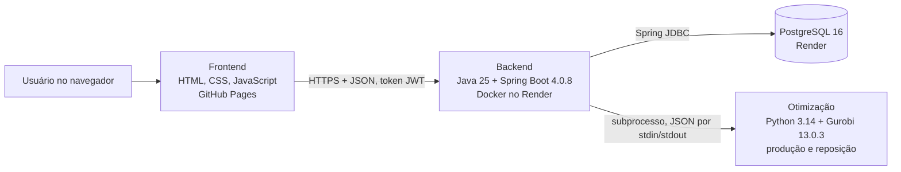

# Documentação Final — Mente Fria

**Equipe:** Leonardo Fagundes Oliveira (RA 2840482421009) — Diogo Pereira Miranda (RA 2840482423006) — Lucas Gabriel Valadares Bassi (RA 2840482423008) — Kauê Nogueira Carneiro (RA 2840482423039)

**Deploy definitivo:** https://kauencarneiro.github.io/Mente_Fria/ (frontend) · https://mente-fria-backend.onrender.com (backend; teste: `GET /api/saude`)

**Repositório:** https://github.com/KaueNCarneiro/Mente_Fria

## 1. Índice de artefatos do semestre
| Entrega | Documento | Link |
|---|---|---|
| E1 | Documento de Visão | [Documento_de_Visão____Mente_Fria_.docx](<Documento_de_Visão____Mente_Fria_.docx>) |
| E2 | Backlog + Termo de Aceite do Projeto | [Backlog_Priorizado_Mente_Fria.docx](Backlog_Priorizado_Mente_Fria.docx) · [Termo_de_Aceite_Mente_Fria.docx](Termo_de_Aceite_Mente_Fria.docx) · Adendo nº 1 ao Termo: [sprint-3-adendo-termo-de-aceite.md](Sprint_3/sprint-3-adendo-termo-de-aceite.md) |
| E3 | UML + DER + DDL | [Diagramas_UML.md](Diagramas_UML.md) · [DER.md](DER.md) · [bd/Script_DDL.sql](../bd/Script_DDL.sql) |
| E4 | README + Protótipo + Plano de Testes | [README.md](../README.md) · [Roteiro do Protótipo Navegável](<Roteiro do Protótipo Navegável — Mente Fria.md>) · [Plano_de_Testes_Mente_Fria.md](Plano_de_Testes_Mente_Fria.md) |
| E5–E8 | Relatórios de sprint | Sprint 1: [relatório](Sprint_1/sprint-1-relatorio.md), [retrospectiva](Sprint_1/sprint-1-ata-retrospectiva.md) · Sprint 2: [relatório](Sprint_2/sprint-2-relatorio-entrega.md), [retrospectiva](Sprint_2/sprint-2-retrospectiva.md), [evidências](Sprint_2/sprint-2-evidencias-teste.md) · Sprint 3: [relatório](Sprint_3/sprint-3-relatorio-entrega.md) · Sprint 4: [relatório](Sprint_4/sprint-4-relatorio-entrega.md), [registro de análise das Sprints 2 a 4, sem reunião](Sprint_4/sprint-4-retrospectiva.md), [semana de testes](Sprint_4/sprint-4-semana-de-bugs.md), [evidências](Sprint_4/evidencias/) · Contribuições individuais: `sprint-N-contribuicao-<nome>.md` em cada pasta `Sprint_N/` |
| E9 | Relatório de testes + Termo de Aceite do Cliente | [relatorio-testes-final.md](relatorio-testes-final.md) · [termo-aceite-cliente.md](termo-aceite-cliente.md) |

## 2. Desvios do escopo original (vs. E2b)
| Item | Mudou? | Justificativa |
|---|---|---|
| Otimização da produção | Sim | Passou a maximizar o **lucro estimado** (preço menos custo dos ingredientes), e não a receita. Lucro é o que importa para o dono da açaiteria. Aprovado pelo professor no Adendo nº 1 (27/10/2026), item 1 |
| Recomendação de reposição | Sim | Ganhou o **orçamento** informado pelo usuário e o consumo de um período. Adendo nº 1, item 2 |
| Dashboard gerencial | Sim | A “receita máxima estimada” passou a vir do último plano de produção (receita e lucro estimados), junto com o faturamento do mês, os mais vendidos e o ranking de vendas. Adendo nº 1, item 3 |
| Alerta de validade e de reposição (US15, US16) | Sim | Entregues em parte, pela opção (a) do Adendo nº 1, item 4: situação “Vence em breve” (até 7 dias) e “Vencida” em cada linha de estoque, “Abaixo do mínimo” por ingrediente e contagens no dashboard. Os alertas completos ficaram fora do semestre |
| Controle de estoque | Sim | O estoque passou a ser controlado por **linhas de entrada com validade**, com baixa da menor validade primeiro e descarte de linha vencida, para que um ingrediente vencido nunca seja vendido nem entre na recomendação (Arquitetura, D10) |
| Clientes (US13), exportar CSV (US19), cancelar pedido (US27) | Não | Não estavam no escopo aceito (Must + Should): são *Could* do Backlog e ficaram fora do semestre; sem sprint de desenvolvimento depois da entrega. Adendo nº 1, item 6 (decisão A40) |
| Porção padrão por unidade de medida (US26) | Sim | Entregue a mais: estava fora do escopo (Adendo nº 1); entrou em 12/11/2026, depois do obrigatório, por decisão do PO (A46). O professor foi avisado e concordou |
| Publicação | Sim | Mudou a data: planejada para 02/11 (A41); feita em 11/11/2026, na conta do Render do Diogo (A47). Deploy automático desde 15/11 |
| Licença do Gurobi no sistema publicado | Sim | A licença acadêmica (WLS) é pessoal e não pode ser usada numa URL pública. O sistema publicado usa a licença do `pip`, com autorização escrita da Gurobi (28/10/2026) |
| Sprint Review | Sim | A Review marcada para 06/11 não foi realizada. O fluxo foi testado na URL publicada em 14 e 15/11 ([relatório de testes](relatorio-testes-final.md)) |

## 3. Arquitetura final (resumo)

- **Frontend:** JavaScript puro em módulos (sem build), publicado pelo GitHub Pages a cada push na `main` que mexe no frontend.
- **Backend:** API REST com login por token JWT e dois perfis (Administrador e Funcionário). O acesso a dados usa Spring JDBC com parâmetros nomeados, sem JPA.
- **Otimização:** o backend chama o Python como subprocesso a cada recomendação. Os modelos matemáticos estão em [Apoio/Modelo_Matematico_Producao.md](Apoio/Modelo_Matematico_Producao.md) e [Apoio/Modelo_Matematico_Reposicao.md](Apoio/Modelo_Matematico_Reposicao.md).
- **Formatos de comunicação:** as rotas e os formatos JSON estão no [Contrato de Comunicação](Apoio/Contrato_de_Comunicacao_Mente_Fria.md). As decisões de arquitetura estão em [Arquitetura.md](Apoio/Arquitetura.md).
- **Banco gratuito do Render:** vence em **11/12/2026, às 21h59**, depois da data-limite de 30/11. Há backups com restauração testada.

O que mudou desde a E4:
- a forma de chamar a otimização foi fechada: subprocesso dentro do mesmo container (D2), que na E4 ainda estava em aberto (subprocesso ou serviço HTTP);
- o deploy foi feito em Docker no Render;
- o estoque passou a ser controlado por linhas de entrada.

## 4. Como contribuir/rodar
Siga o [README](../README.md): pré-requisitos, passo a passo para subir o projeto do zero (conferido em 15/11 no CT20), variáveis de ambiente, testes e convenções da equipe. O uso do sistema, por perfil, está no [Manual do Usuário](manual-do-usuario.md).
