# Manual do Usuário — Mente Fria

**Equipe:** Leonardo Fagundes Oliveira (RA 2840482421009) — Diogo Pereira Miranda (RA 2840482423006) — Lucas Gabriel Valadares Bassi (RA 2840482423008) — Kauê Nogueira Carneiro (RA 2840482423039)

O Mente Fria ajuda o dono de uma açaiteria a controlar o estoque e os pedidos e a decidir quanto preparar de cada copo para ter o maior lucro. Acesse em **https://kauencarneiro.github.io/Mente_Fria/**.

Há dois perfis:
- **Administrador (proprietário):** usa todas as telas.
- **Funcionário:** registra o estoque e os pedidos.

As imagens são do sistema publicado, em 15 e 20/11/2026.

## Para o Administrador

### Como criar a conta de proprietário (só na primeira vez)
1. Na tela de entrada, clique em **Ainda não tem conta? Criar conta de proprietário**.
2. Preencha **Nome completo**, **E-mail**, **Senha** (mínimo de 8 caracteres) e **Confirmar senha**.
3. Clique em **Criar conta e entrar**. Você entra direto como Administrador.

A conta de proprietário é criada uma vez só. As outras pessoas entram como funcionários, cadastradas por você.

### Como entrar e sair
1. Informe o **e-mail** e a **senha** e clique em **Entrar**.
2. O menu lateral mostra as telas do seu perfil. Para sair, clique em **Sair**, no canto superior direito.

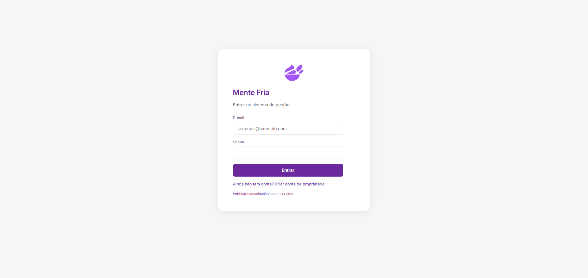

### Como cadastrar um funcionário
1. No menu, abra **Funcionários** e clique em **+ Novo funcionário**.
2. Preencha **Nome completo**, **E-mail** (não pode repetir) e **Senha** (mínimo de 8 caracteres) e clique em **Salvar funcionário**.
3. Aparece “Funcionário cadastrado com sucesso.” O funcionário já pode entrar com esse e-mail e essa senha.

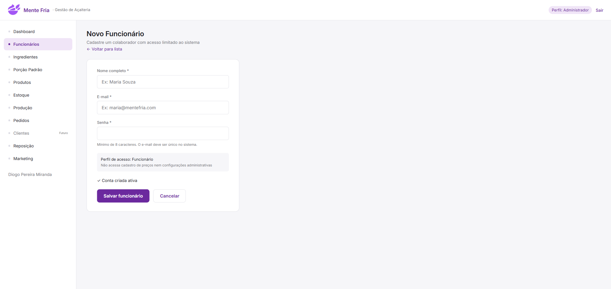

### Como cadastrar um ingrediente
1. No menu, abra **Ingredientes** e clique em **+ Novo ingrediente**. Para mudar um ingrediente que já existe, clique em **Editar** na linha dele.
2. Preencha:
   - **Nome do ingrediente**;
   - **Unidade de medida**;
   - **Custo unitário (R$)**;
   - **Porção padrão**: o sistema já sugere a porção da unidade escolhida, e você pode mudar;
   - **Quantidade mínima em estoque**.
3. Clique em **Salvar ingrediente**. Aparece “Ingrediente salvo com sucesso.”

O estoque do ingrediente não é digitado aqui: ele entra pelas movimentações de estoque, com a validade (veja adiante).

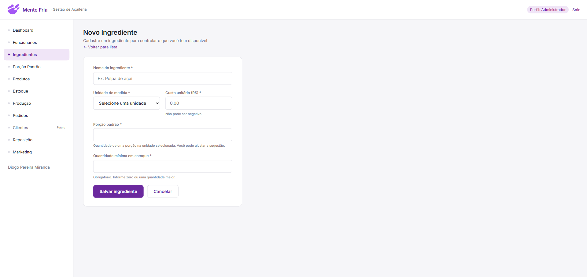

### Como definir a porção padrão de cada unidade
1. No menu, abra **Porção Padrão**. A tela mostra as unidades (kg, L, mg, ml, un) e a porção de cada uma.
2. Para criar uma unidade, preencha **Unidade de medida** e **Porção padrão** em **Nova unidade** e clique em **Cadastrar unidade**.
3. Para mudar a porção de uma unidade, altere o valor na coluna **Alterar a porção** da linha dela e clique em **Salvar**.

Mudar a porção de uma unidade **não muda** os ingredientes que já foram cadastrados. Ela vale como sugestão para os próximos.

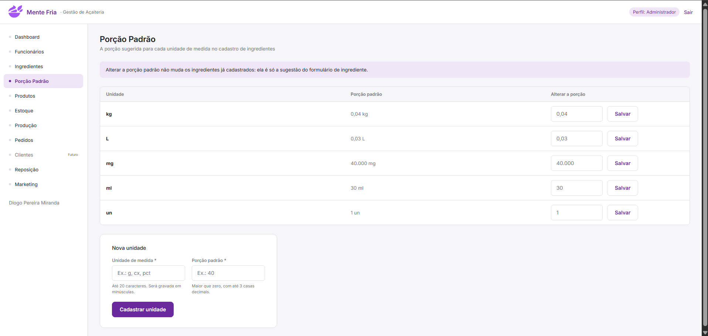

### Como cadastrar um produto (copo de açaí) e mudar o preço
1. No menu, abra **Produtos** e clique em **+ Novo produto**.
2. Preencha:
   - **Nome do produto**, com o tamanho (ex.: “Açaí 500ml”);
   - **Preço de venda (R$)**.
3. Em **Composição (ingredientes)**, escolha um ingrediente, clique em **+ Adicionar ingrediente** e informe a quantidade de porções usada no copo. Repita para cada ingrediente. O produto precisa ter **Açaí**.
4. Clique em **Salvar produto**. Aparece “Produto cadastrado com sucesso.”
5. Para mudar o preço depois, clique em **Alterar preço** na linha do produto, informe o novo valor e clique em **Salvar preço**. Só o Administrador pode fazer isso.

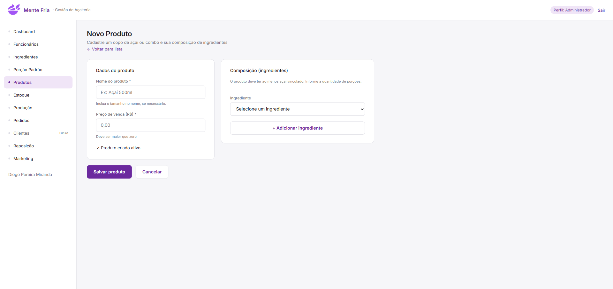

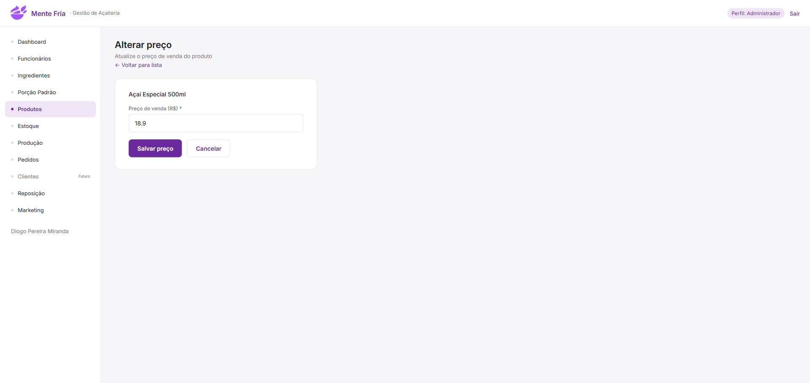

### Como acompanhar e movimentar o estoque
1. No menu, abra **Estoque**. Cada ingrediente aparece com as colunas **Total**, **Válido**, **Vencido**, **Validade mais próxima** e **Situação**. “Abaixo do mínimo” quer dizer que é hora de comprar.
2. Clique em **Ver linhas** para ver cada entrada do ingrediente, com a sua validade e a situação: “Dentro da validade”, “Vence em breve” (até 7 dias), “Vencida” ou “Sem validade”.
3. Para registrar uma movimentação, clique em **+ Registrar movimentação** e preencha:
   - **Ingrediente**;
   - **Tipo**: **Entrada** ou **Saída**;
   - **Quantidade**;
   - na entrada, a **Validade** (opcional, mas recomendada: sem ela, a linha fica “Sem validade” e é usada por último);
   - na saída, o **Motivo da saída**: **Saída convencional** ou **Descarte de vencidos**;
   - se quiser, a **Observação** (ex.: “Lote 3”).

   Depois, clique em **Registrar movimentação**.
4. Para jogar fora o que venceu, clique em **Descartar** na linha vencida e confirme. Só a linha vencida escolhida é zerada.

A saída sempre usa primeiro o ingrediente que vence antes. Ingrediente vencido **nunca** é vendido nem entra no cálculo de produção.

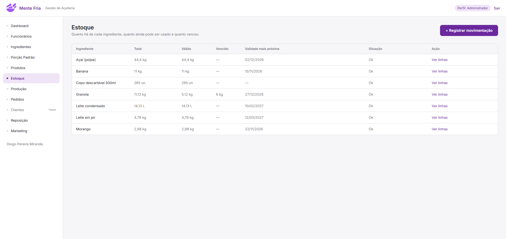

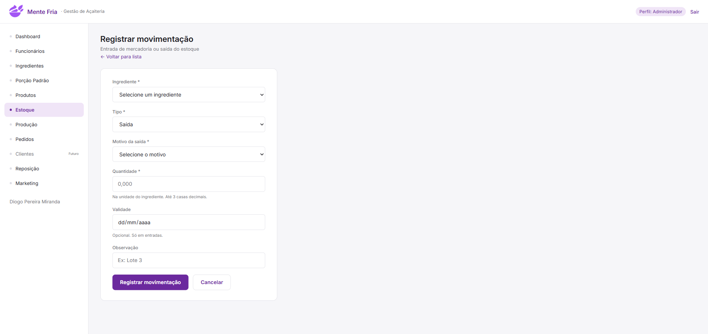

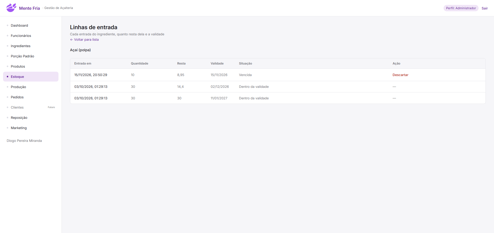

### Como saber quanto preparar de cada copo (Produção)
1. No menu, abra **Produção** e clique em **Gerar recomendação**.
2. O sistema usa o estoque válido, a composição e o preço de cada copo e mostra:
   - quanto preparar de cada copo;
   - o **lucro potencial**;
   - a **receita estimada**.
3. Quando um copo fica com **0**, a observação explica o motivo:
   - **“Sem lucro”**: o copo não dá lucro com os preços e custos atuais;
   - **“O estoque não dá ou rende mais em outro copo”**: falta ingrediente para ele, ou o mesmo ingrediente dá mais lucro em outro copo.

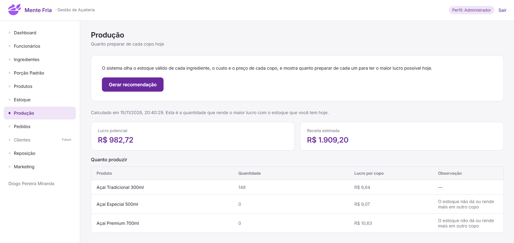

### Como ver as sugestões de campanha (Marketing)
1. No menu, abra **Marketing**. As sugestões usam o último cálculo da Produção e destacam os copos que vale a pena vender mais.
2. Se ainda não houver cálculo, a tela mostra um aviso e o link **Ir para Produção**.

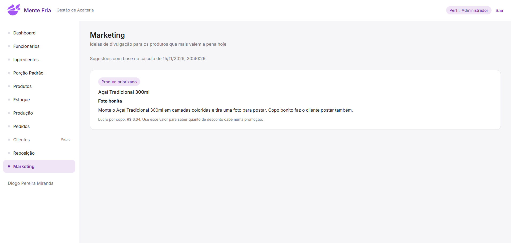

### Como saber o que comprar (Reposição)
1. No menu, abra **Reposição**.
2. Informe o **Período (dias)** de consumo a considerar e o **Orçamento (R$)** que você tem para comprar.
3. Clique em **Gerar sugestão de compra**. A tela mostra quanto comprar de cada ingrediente e o custo. Se o orçamento não der para tudo, o sistema reparte o dinheiro entre os ingredientes e avisa.

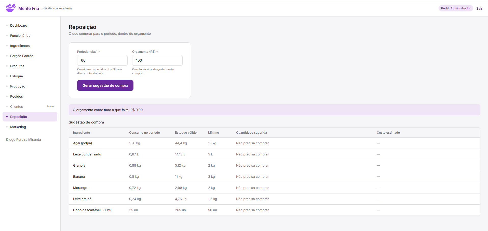

### Como acompanhar o negócio (Dashboard)
1. No menu, abra **Dashboard**. A tela abre no mês atual e mostra:
   - o **faturamento do mês**;
   - os ingredientes **abaixo do mínimo** e os com **quantidade vencida**;
   - o último plano de produção;
   - os produtos mais vendidos e os ingredientes mais usados;
   - o ranking de vendas por usuário.
2. Para ver outro período ou recorte, escolha o **Mês**, o **Usuário**, uma faixa de valor (**Valor mínimo** e **Valor máximo**) ou marque um **Tipo de produto**, e clique em **Aplicar filtros**.

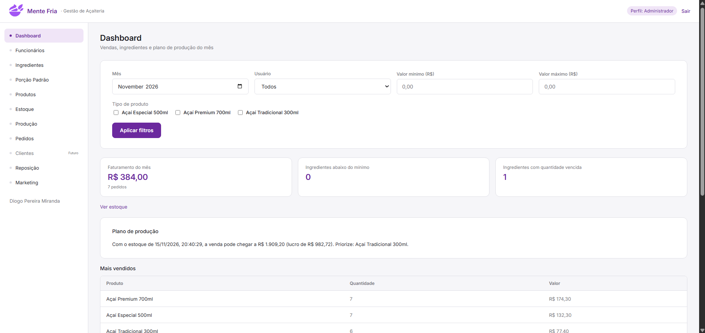

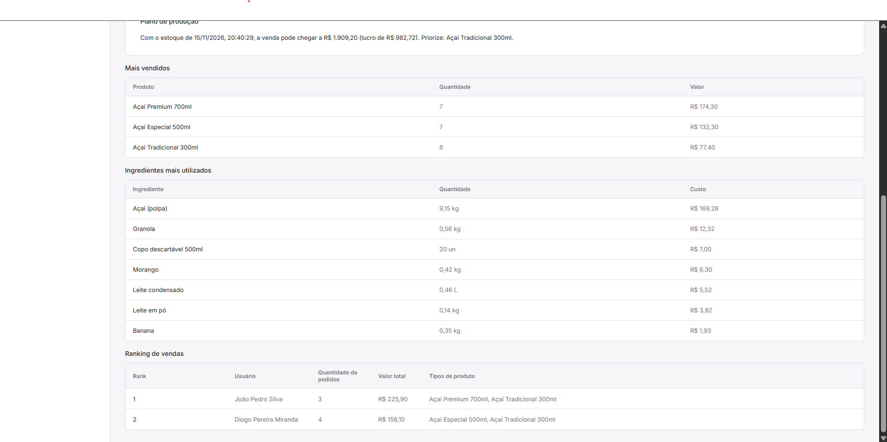

## Para o Funcionário

### Como entrar
1. Informe o e-mail e a senha que o Administrador cadastrou para você e clique em **Entrar**.
2. O seu menu tem **Início**, **Ingredientes**, **Produtos**, **Estoque** e **Pedidos**.

### Como registrar a chegada de mercadoria (entrada de estoque)
1. Abra **Estoque** e clique em **+ Registrar movimentação**.
2. Escolha o **Ingrediente**, o tipo **Entrada**, a **Quantidade** e a **Validade** (opcional, mas recomendada). Se quiser, preencha a **Observação** (ex.: “Lote 5”).
3. Clique em **Registrar movimentação**. Aparece “Movimentação registrada.”, e o total do ingrediente aumenta.

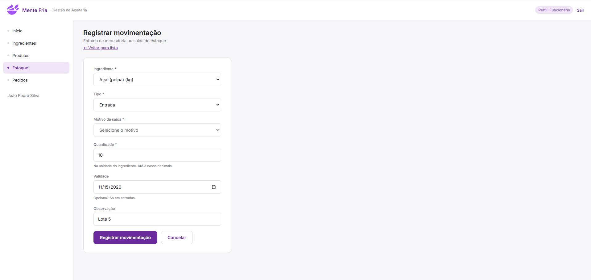

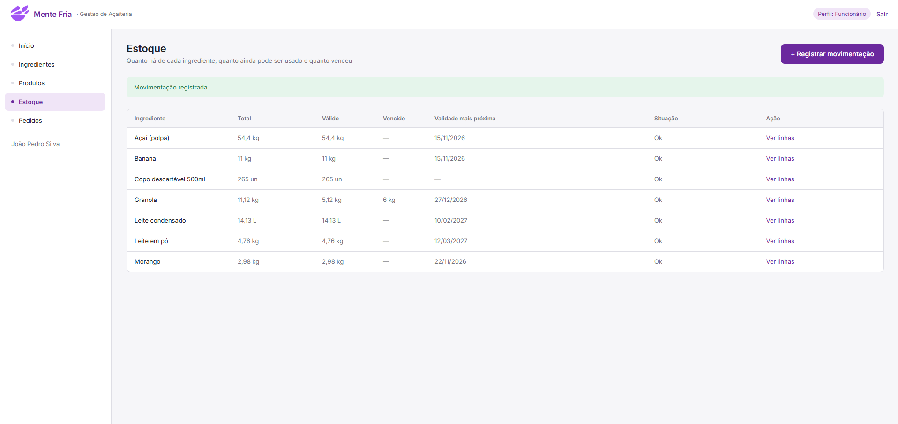

### Como consultar o estoque
1. Abra **Estoque** para ver a lista dos ingredientes.
2. Clique em **Ver linhas** para ver as entradas de um ingrediente e as suas validades.

A saída de estoque e o **Descartar** funcionam como na seção do Administrador.

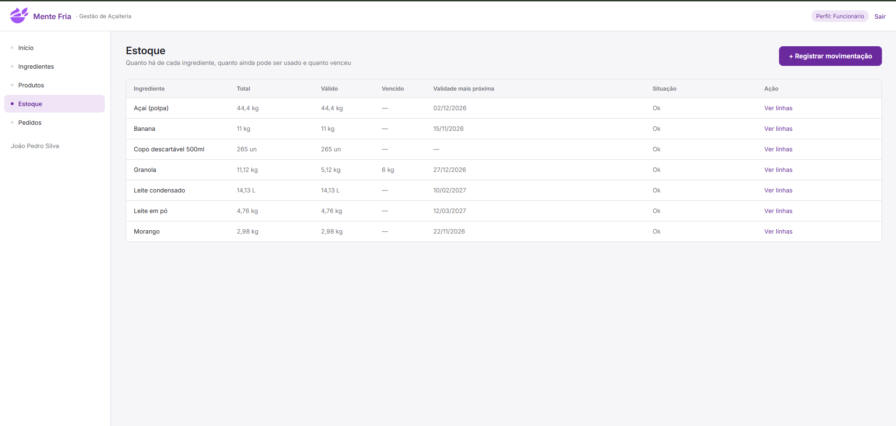

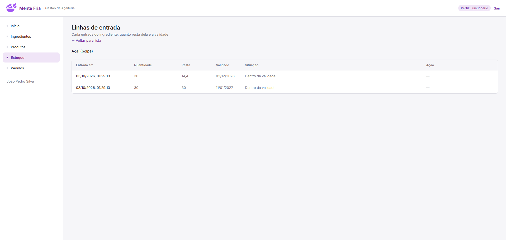

### Como registrar um pedido
1. Abra **Pedidos** e clique em **+ Novo pedido**.
2. Escolha o **Produto** e clique em **+ Adicionar produto**. Ajuste a quantidade com **−** e **+** ao lado do produto. Repita para cada produto do pedido. O total aparece na tela.
3. Clique em **Confirmar pedido**. Aparece “Pedido registrado. Total: R$ …”.

Os ingredientes de cada copo saem do estoque automaticamente. Se faltar ingrediente válido para algum item, o pedido não é registrado e a tela mostra o motivo.

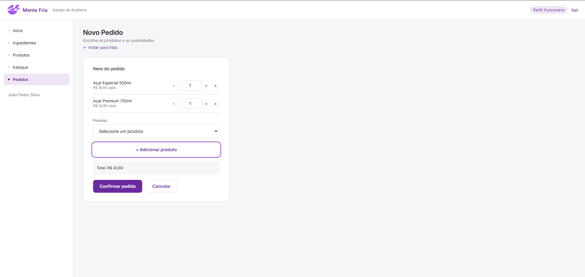

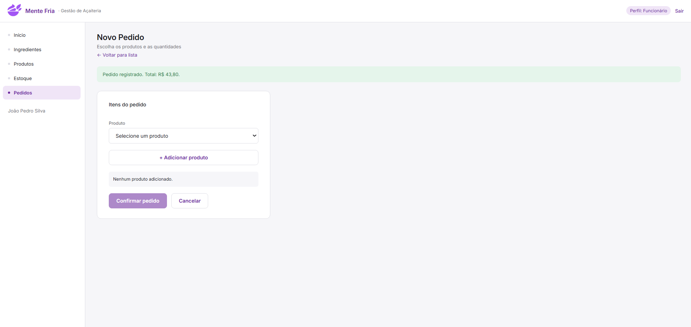

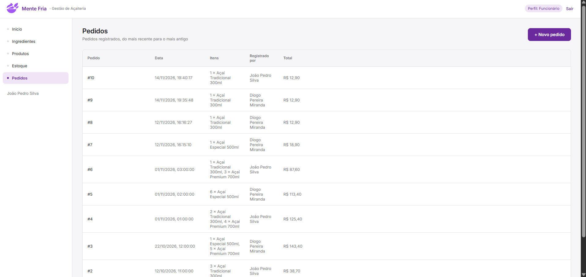

### Telas só do Administrador
Se você abrir o endereço de uma tela do Administrador, o sistema volta ao **Início** e mostra o aviso “Esta área é exclusiva do Administrador.”

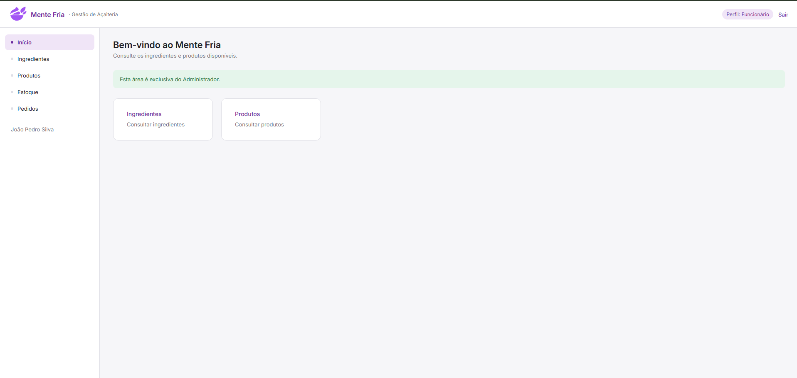

## Perguntas frequentes

**O sistema demorou para abrir. Está fora do ar?**
Provavelmente não. Depois de um tempo sem uso, o servidor “dorme”, e a primeira ação (entrar ou abrir uma lista) pode levar cerca de um minuto, no máximo um minuto e meio. Depois disso, ele responde normalmente. Se aparecer “O servidor demorou para responder”, tente de novo.

**Por que um copo ficou com 0 na Produção?**
Leia a observação ao lado do copo. “Sem lucro” quer dizer que o preço não cobre o custo. “O estoque não dá ou rende mais em outro copo” quer dizer que falta ingrediente ou que o mesmo ingrediente dá mais lucro em outro copo.

**Tenho estoque, mas o sistema diz que não há o suficiente. Por quê?**
O sistema só conta o que está dentro da validade. Veja em **Estoque**, na coluna **Vencido**, ou em **Ver linhas**. O que venceu pode ser descartado com **Descartar**.

**Posso cancelar um pedido?**
Não. O cancelamento de pedidos ficou para uma versão futura.

**O que é o item Clientes, marcado como “Futuro”, no menu?**
É o cadastro de clientes, que ficou para uma versão futura. Por enquanto, não dá para escolher o cliente no pedido.
